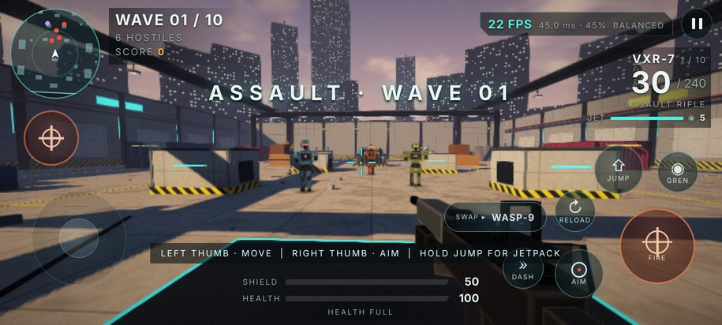
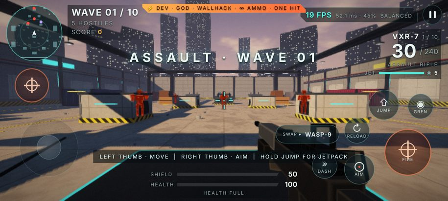

# Aurelia Strike 5.0 — Overdrive Update

A wave-survival 3D shooter for Android: WebGL game code in `android/assets/`, hosted by a native Java activity.



## Install

1. Uninstall Aurelia Strike 4.0 first. 5.0 is signed with a new key because the 4.0 key (`development-key.pem`)
   was not in the uploaded files, so Android refuses to install it as an update. Uninstalling clears saved settings and best wave.
2. Install [`release/Aurelia-Strike.apk`](release/Aurelia-Strike.apk) (Android 6.0+, allow "Install unknown apps").

## What's new in 5.0

**Graphics.** New WebGL2 renderer (WebGL1 fallback): late-afternoon sun with a baked shadow map and soft PCF shadows,
baked ground ambient occlusion, linear lighting with ACES tone mapping, procedural sky with sun and clouds, height fog,
bevelled box edges, material types (concrete panels, wet floor tiles, corrugated containers, hazard stripes, glass visors,
lit city towers), up to 8 dynamic lights (muzzle flashes, explosions, street lamps), GPU particles (sparks, smoke,
fireballs, tracers, shockwaves), shell casings, and a bloom + FXAA + colour grading post stack.

**Models.** Robots rebuilt from boxes, cylinders and spheres with a walk cycle, aiming, glowing visors, per-type gear
(rusher blades, sniper hood and long rifle, medic drone, bomber tanks, juggernaut shoulder cannons), hit flashes and
death falls. Ten distinct first-person guns with recoil, sway, sprint pose, reload animation, pump/slide/rotating barrels.
The Longshot has a real scope.

**Arena.** Same tested collision layout plus shipping containers, generators, supply depots, barrels, crates, lamp posts,
gantries with light panels and a city skyline.

**Gameplay.** Jump and jetpack (hold JUMP) to climb onto cover and containers. Field upgrades: choose one of three perks
after every wave (12 perks). Score, kill streaks and medals. Auto-fire option, aim assist, damage numbers,
damage-direction indicators, radar, low-health heartbeat.

**Audio.** Every sound is synthesised at startup: a distinct report for each gun, stereo-panned enemy fire, explosions,
reload stages, footsteps, jetpack, UI sounds and two music loops.

**UI and settings.** New HUD, menu with mode cards and weapon stats, perk cards, results screen, and a tabbed settings screen:
- Graphics: quality preset, render resolution, dynamic resolution, frame-rate limit (30/60/90/120/MAX), shadows, bloom, FXAA, effects density, field of view, FPS counter.
- Controls: look and aiming sensitivity, invert, gyro aiming (off / while aiming / always), aim assist, auto-fire, left fire button, button size and opacity.
- Controller: stick sensitivity, deadzone, invert, rumble, hide touch buttons.
- Audio: master, effects and music volume.
- Gameplay: difficulty, vibration, damage numbers, radar, crosshair style and colour.

**Controls.** Floating joystick, look acceleration, optional left-side fire button, gyro aiming. Controllers are read natively by the
Android shell (not the WebView Gamepad API) and mapped to the standard layout: RT fire, LT aim, A jump/jetpack, B dash,
X reload, Y/RB swap, LB grenade, R3 toggle aim, Start pause. Menus and settings are fully navigable with the D-pad or stick.

**Android shell.** Immersive full screen, requests the display's highest refresh rate (120 Hz where available),
system font scaling locked so the HUD can't break, phone haptics with amplitude, controller rumble, back button, renderer-crash recovery.

## Dev mode

Tap the **AURELIA STRIKE** logo on the main menu (or the **PAUSED** title during a match) to open the hidden ⚡ DEV tab in Settings:
god mode, wall hacks (enemies glow through walls), unlimited ammo, damage up to one-hit kills, explosive bullets, rapid fire,
no recoil, super speed, unlimited jetpack fuel and grenades, freeze enemies, slow motion, plus kill all, skip 5 waves,
refill, unlock every perk, +10,000 score and a reset button. A badge at the top of the HUD lists the cheats that are on.



## Build and test

```
tools/build-apk.sh                 # aapt, javac, dx, zipalign, apksigner -> release/Aurelia-Strike.apk
node tests/fps.test.cjs            # 47 behaviour tests (36 from 4.0, 4 adjusted for new controls/perks, 11 new)
node tests/browser.cjs [outDir]    # runs the real game with WebGL in headless Chromium; fails on any error; saves screenshots
java tools/IconGen.java android/res release/icon-512.png
```

## Not verified

No phone, emulator or controller is attached to the build machine. Install, touch feel, frame rate on a real GPU and physical
controller input are untested. The browser test renders with software WebGL, so its FPS numbers say nothing about a phone.
`archive/` keeps the 1.0–4.0 APKs and the 4.0 game files.
