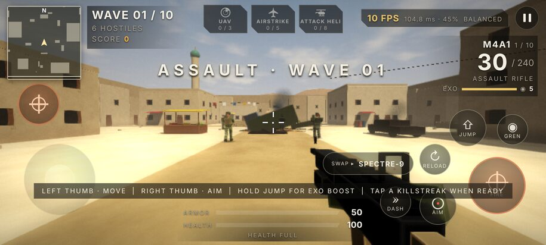
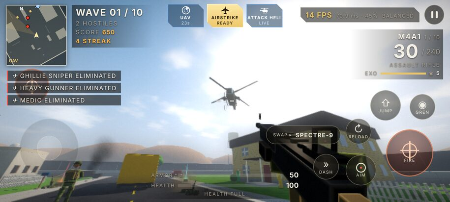
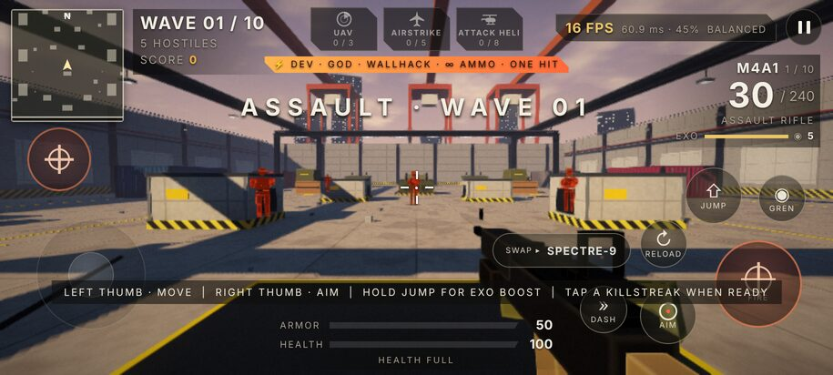

# Max Power Arena 6.0 — Frontline Update

A military wave-survival 3D shooter for Android (formerly Aurelia Strike). The game is JavaScript + WebGL (GLSL shaders)
in `android/assets/`, with HTML/CSS for the HUD and menus, hosted by a native Java activity.



## Install

Install [`release/Max-Power-Arena.apk`](release/Max-Power-Arena.apk) (Android 6.0+, allow "Install unknown apps").
It uses the same package and signing key as Aurelia Strike 5.0, so it installs as an update over 5.0 and keeps your
settings, best wave and dev-mode unlock.

## What's new in 6.0

A modern-military makeover, inspired by classic Call of Duty multiplayer. All maps, models and names are original.

**Three maps** (pick one on the main menu or in Settings → Gameplay):
- **Dockyard** (dusk): the original container-port layout, re-lit with sodium lamps, container stacks, cranes and a port skyline.
- **Dust Town** (noon): adobe buildings, a crashed helicopter that keeps burning, market stalls, palms, sandbags, a minaret and desert mountains.
- **Atomic Suburb** (morning): a nuclear-test-site cul-de-sac with two houses, garages, a school bus, cars, picket fences, mannequins and a water tower.

Each map has its own sun, sky, fog and colour grade. New materials: camouflage cloth, plaster, sand/asphalt, grass and painted wood.

**Soldiers.** Enemies are now soldiers: helmets, plate carriers with pouches, camouflage uniforms, knee pads, varied skin tones,
gloves and held rifles. Classes: Rifleman, Breacher (black balaclava, shotgun), Heavy Gunner (armoured, LMG), Ghillie Sniper
(leafy ghillie suit), Medic (red-cross pack, heals allies), Grenadier (lobs grenades), and the armoured Juggernaut boss
with a minigun. Hits throw blood mist; kills drop the body.

**Weapons.** Grounded military guns with no neon: M4A1, Spectre-9 SMG, M870 Breacher, LR .50 sniper (scope), M60, RPG-7,
M1911, AUTO-12, MK-14 EBR and M134 Minigun. Camo sleeves and gloves in first person.

**Killstreaks** (kills in a row; taking damage does not reset them):
- **UAV** (3 kills): every enemy shows on the minimap for 30 s, with a radar sweep.
- **Airstrike** (5 kills): two jets fly over and carpet-bomb the biggest enemy group.
- **Attack Heli** (8 kills): a gunship circles the map for 25 s and guns down enemies it can see.

Tap the glowing icon at the top of the screen, press D-pad up on a controller, or F on a keyboard.



**HUD.** Gold-and-charcoal theme, square rotating minimap (enemies appear when they fire, when close, or during a UAV),
killstreak tray with progress, ARMOR/HEALTH bars, EXO boost meter, white default crosshair.

**Audio.** New synthesised sounds: jet flyby, helicopter rotor loop, killstreak radio cues, body falls.

## Still here from 5.0

Jump and exo boost (hold JUMP) onto cover, 12 field upgrades between waves, medals, 4 difficulties including Endless,
graphics/controls/controller/audio/gameplay settings, gyro aiming, auto-fire, full controller support, 120 Hz displays.

## Dev mode

Tap the **MAX POWER ARENA** logo on the main menu (or the **PAUSED** title during a match) to open the hidden ⚡ DEV tab:
god mode, wall hacks, unlimited ammo, damage up to one-hit kills, explosive bullets, rapid fire, no recoil, super speed,
unlimited exo fuel and grenades, freeze enemies, slow motion, plus kill all, skip 5 waves, refill, every perk,
**every killstreak**, +10,000 score and a reset button.



## Build and test

```
tools/build-apk.sh                 # aapt, javac, dx, zipalign, apksigner -> release/Max-Power-Arena.apk
node tests/fps.test.cjs            # 53 behaviour tests (47 from 5.0 + maps and killstreaks)
node tests/browser.cjs [outDir]    # runs the real game with WebGL in headless Chromium; fails on any error; saves screenshots
java tools/IconGen.java android/res release/icon-512.png
```

## Not verified

No phone, emulator or controller is attached to the build machine. Install, touch feel, frame rate on a real GPU and physical
controller input are untested. The browser test renders with software WebGL, so its FPS numbers say nothing about a phone.
`archive/` keeps the Aurelia Strike 1.0–4.0 APKs and the 4.0 game files.
