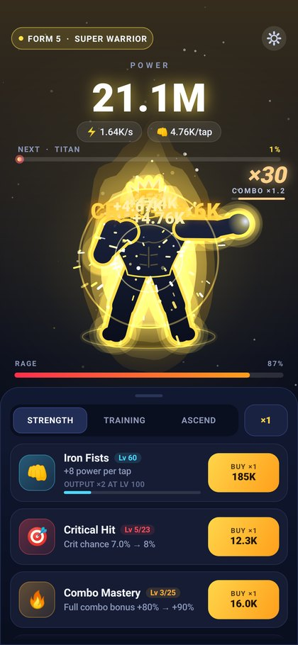
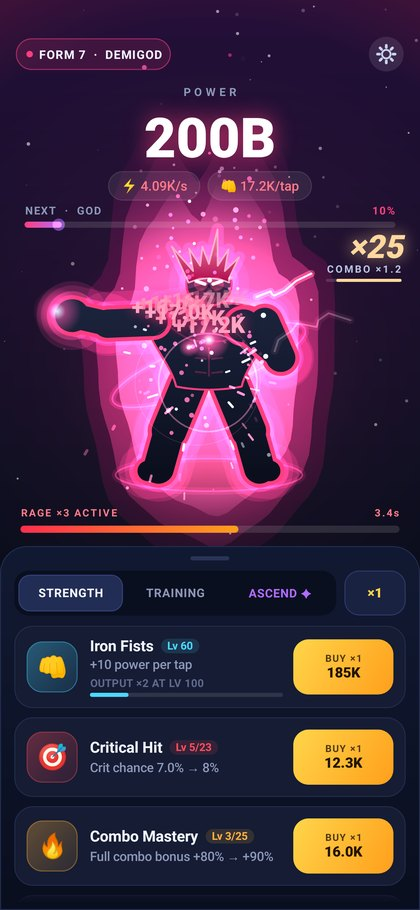
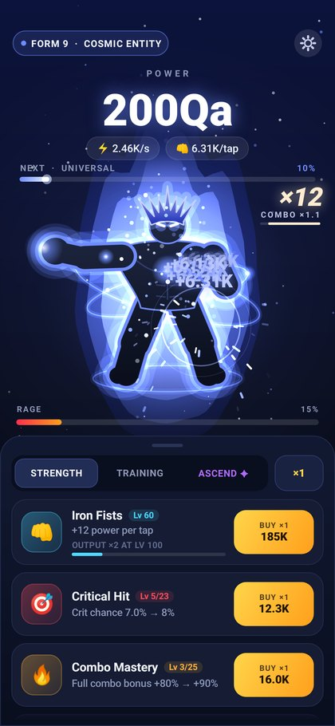
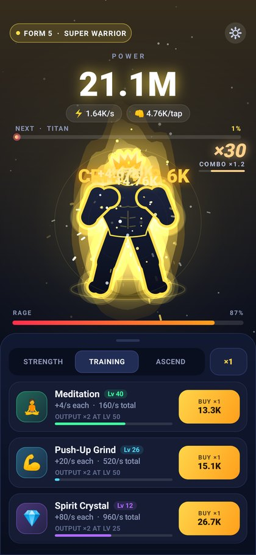
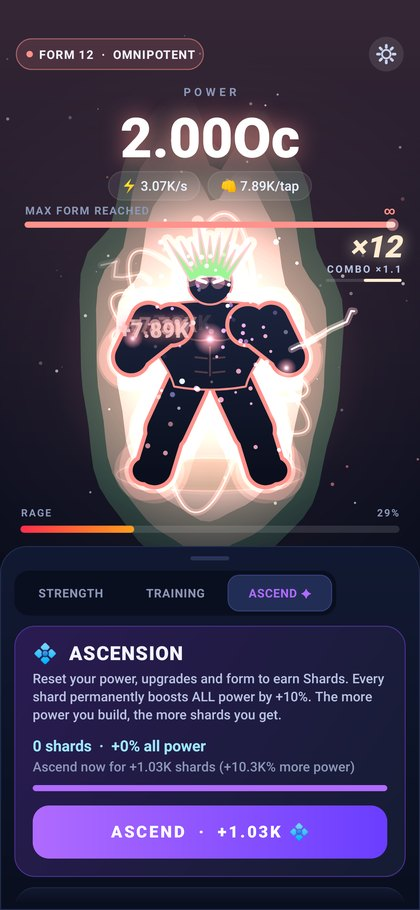

# ⚡ Power Simulator

A fast, flashy tap-to-power-up Android game written in plain Java: no game engine, no libraries.
Tap to gain power, buy upgrades, and watch your fighter evolve through 12 forms, from **Mortal** to **Omnipotent**.

<p>
  
  
  
  
  
</p>

## Install on your phone

1. Download [`release/PowerSimulator.apk`](release/PowerSimulator.apk) on your Android phone (Android 7.0 or newer).
2. Open it and allow "Install unknown apps" for your browser or file manager when asked.
3. Tap **Install** and play.

## Gameplay

- **Tap anywhere** to punch and gain power. Multi-touch works, so tap with several fingers.
- **Combo:** keep tapping to build a combo. Its tap-power bonus keeps growing until you hit a ×100 combo.
- **Critical hits** randomly deal huge damage, with a gold flash and screen shake.
- **Rage:** tapping fills the rage bar. When it's full, hit **UNLEASH RAGE** for a burst of multiplied tap power and passive power.
- **Strength upgrades:** tap power, crit chance, crit damage, combo, rage and synergy (taps also earn part of your power/sec).
- **Training upgrades:** 16 passive generators, from Meditation to Beyond Existence. Every milestone level (25, 50, 100, ...) doubles that upgrade's output.
- **12 forms:** the character visibly changes as total power grows. The aura, spiky hair, glowing eyes, chest core, lightning and orbiting energy rings all scale up, and each form also adds +25% to all power.
- **Ascension:** at Titan form you can reset for Shards. Each shard gives +10% to all power, permanently.
- **Offline progress:** your character keeps training while you're away (50% speed, up to 4 hours).
- Progress autosaves. The ⚙ button has sound, haptics and reset options.

## Project layout

```
app/src/main/java/com/skyrocket/powersim/
  GameState.java    rules and numbers (pure Java, no Android imports)
  GameView.java     the play area: background, character, aura, particles, HUD (Canvas)
  MainActivity.java upgrade panel, tabs, ascension, dialogs, saving, offline earnings
  SaveManager.java  SharedPreferences persistence
  Sfx.java          SoundPool sound effects
  Fmt.java          big-number formatting (1.24K, 3.5M, 12Qa, ...)
tools/
  IconGen.java      renders the launcher icons
  SoundGen.java     synthesizes the sound effects (WAV)
```

## Building

**Android Studio:** open this `power-simulator` folder as a project and press Run.

**Command line without Android Studio:** `./build-apk.sh` builds `release/PowerSimulator.apk` using the plain Android build tools
(`aapt`, `javac`, `dx`, `zipalign`, `apksigner`). On Ubuntu:
`apt-get install aapt zipalign apksigner dalvik-exchange android-sdk-platform-23`. The script expects an API 35 `android.jar`
at `ANDROID_JAR` (default `/opt/android-jars/android-35.jar`).

To regenerate assets: `java tools/IconGen.java app/src/main/res art/icon-512.png` and `java tools/SoundGen.java app/src/main/res/raw`.

## Signing

Both builds sign with `keystore/debug.keystore` (password `android`), so new versions install over old ones and keep your save.
It is a throwaway debug key. Create your own release key before publishing to Google Play.
